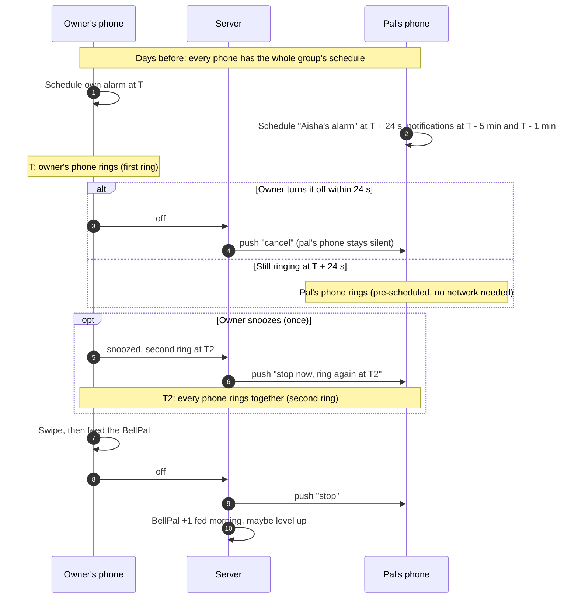

# BellPals — Technical Architecture

| | |
|---|---|
| **Version** | 0.2 · 30 Sep 2026 (proposal, to be confirmed by the Phase 1 real-phone test) |
| **Related** | [PRD](PRD.md) · [Roadmap](ROADMAP.md) · [Design](DESIGN.md) · [Prototype](../prototype/README.md) |

## 1. Stack

| Layer | Choice | Why |
|---|---|---|
| App | **Expo (React Native, TypeScript)** | One codebase for iPhone and Android. The rules already written for the prototype (`prototype/src/domain`) carry over as-is |
| Alarm engine | Our own native module, `bell-engine`: **Swift + AlarmKit** (iOS 26+) and **Kotlin + AlarmManager** (Android 10+) | Alarms must ring through silent mode and with the app closed. Only the OS alarm APIs can do that |
| Backend | **Supabase**: Postgres with row-level security, Auth (Apple + Google), Edge Functions, cron (Singapore region) | Relational data (friends, groups, alarms) with the rules enforced on the server |
| Push | **FCM** (Android, high-priority data messages) and **APNs** (iPhone: background and time-sensitive pushes) | Used to stop, snooze and re-ring pals' phones |
| Builds | EAS Build / Submit, GitHub Actions | Cloud builds for both stores |

## 2. How a group alarm works

The group's alarm schedules are shared with every member's phone, so most of the work happens on the phone without needing the network at ring time.



**Why pre-schedule?** A push can't reliably *start* an alarm on an iPhone. So each phone schedules its pals' first ring (T + 24 s) itself. Pushes are only used to **cancel, stop, snooze and re-ring**.

**Keeping the second ring in sync.** A push carries an absolute time (T2). Every phone schedules its alarm for that instant, so the rings line up within about a second (phone clocks are network-synced).

### Android

- **Scheduling:** `AlarmManager.setAlarmClock()` for the owner's alarm and for pals' alarms at T + 24 s. This is exact and works during Doze.
- **Ringing:** our own foreground service and full-screen activity over the lock screen. So:
  - the swipe-and-feed screen *is* the alarm screen
  - pals' ringing screens have **no stop button** (RING-3)
- **Remote control:** high-priority FCM data messages wake our code to stop, snooze or schedule the second ring. This works even when the app is closed, but not after the user force-stops it.
- **Permissions and Play declarations:**
  - `USE_EXACT_ALARM` and `USE_FULL_SCREEN_INTENT` (alarm-clock apps qualify)
  - notifications permission
  - foreground service type `systemExempted` (allowed for apps with exact alarms)
- **Some phone makers kill background apps.** We guide users to allow BellPals to run (see dontkillmyapp.com for per-brand steps).

### iPhone (iOS 26+, AlarmKit)

- **Scheduling:** AlarmKit alarms ring through silent mode and Focus, even with the app closed. We schedule the owner's alarm and pals' T + 24 s alarms.
- **The alarm screen is Apple's.** It always has a **Stop** button that we can't remove, plus one button of ours (*Feed Ding*, which opens the app for swipe-and-feed).
  - **If a pal taps Stop before the owner is up:** our stop handler re-schedules a ring a few seconds later ("re-ring"), so the rule mostly holds. To be tested.
  - **If the owner taps Stop without feeding:** same re-ring. While the owner is in the app feeding, the app plays the alarm sound itself.
- **Remote control depends on background pushes, which iOS doesn't guarantee.** Delivery is throttled, and there's none at all after the user force-quits the app. **Fallbacks:**
  - A pal's phone may ring for a few seconds even though the owner was up within 24 s.
  - It may keep ringing until the pal taps Stop. The stop handler checks with the server and doesn't re-ring once the owner is up.
- **Known AlarmKit issues** that developers have reported for iOS 26/27 betas:
  - late alarms
  - alarms not firing with the screen on
  - Focus quirks

  All of these are in the test matrix.
- **Critical Alerts** would make pushes ring through silent mode. Apple only grants them to health, safety and security apps, so don't count on it.

### Notifications (5 min and 1 min before)

- **Scheduled as local notifications on each phone**, from the shared schedule, so they work offline.
- **iOS allows 64 pending local notifications per app.** A full group can have 5 alarms × 7 days × 2 = 70, so we schedule a rolling 3-day window and top it up whenever the app runs.

## 3. Data model (Postgres)

| Table | Columns | Rules |
|---|---|---|
| `profiles` | `id` (auth user), `username` (unique), `full_name`, `time_zone` | Username 3–20 chars `[a-z0-9._]` |
| `friend_requests` | `from_id`, `to_id`, `status` | — |
| `friendships` | `user_a`, `user_b` (`user_a < user_b`) | Created when a request is accepted |
| `groups` | `id`, `name`, `owner_id` | Only the owner can delete |
| `group_members` | `group_id`, `user_id` (**unique**, one group per person) | Max 5 members, enforced by a database trigger |
| `group_invitations` | `group_id`, `from_id`, `to_id`, `status` | Inviter must be a member and a friend of the invitee. Pending invites count toward the 5 |
| `alarms` | `user_id`, `weekday` (0 = Sunday), `time_local`, `enabled` | **Unique (`user_id`, `weekday`)**: one alarm per day |
| `bellpals` | `user_id`, `species`, `level` (1–15), `feeds` | Level changes happen on the server only |
| `ring_sessions` | `owner_id`, `group_id`, `first_ring_at`, `snoozed_at`, `second_ring_at`, `off_at`, `member_ids` | One live session per alarm |
| `devices` | `user_id`, `platform`, `push_token`, `time_zone`, `last_seen_at` | — |

**Row-level security:**
- People can read the profiles of friends and group-mates, and minimal fields for username search.
- Groups, invitations and schedules are readable by the people involved only.
- All changes go through server functions that enforce the rules above.

## 4. Server functions

| Area | Functions |
|---|---|
| Friends | `send_friend_request`, `answer_friend_request`, `match_contacts` (hashed) |
| Groups | `create_group`, `invite_to_group`, `answer_invitation`, `leave_group`, `delete_group` (owner only) |
| Alarms | `set_alarm(days, time)` (replaces those days), `toggle_alarm`, `remove_alarm` |
| Ringing | `report_snooze(session)`: once only; returns the shared second-ring time and pushes it to the group |
| | `report_off(session)`: pushes stop to the group; feeds the BellPal (levels are computed on the server) |
| Cron (every minute) | Opens ring sessions at alarm time, and closes stale ones (see the safety cut-off question) |
| Account | `delete_account`: deletes the data, deletes owned groups, and **revokes Sign in with Apple tokens** (Apple requires this) |

## 5. Contacts

Most phone contacts have phone numbers, but sign-in gives us emails. The proposal for v1:
1. **Match by email:** hash contacts' emails on the phone and compare them on the server.
2. **Invite everyone else** with a link (SMS / WhatsApp share sheet). When they install and sign up through the link, a friend request is created.

Phone-number matching needs verified numbers (SMS codes cost money per message), so it's left for later if needed. The address book is never uploaded or stored.

## 6. Phase 1 real-phone test matrix

Run on at least **2 iPhones (iOS 26 + iOS 27) and 2 Android phones** (e.g. a Pixel plus a Samsung or Xiaomi), because group ringing needs several phones.

| # | Scenario | Pass |
|---|---|---|
| 1 | Owner's alarm: locked, silent, Focus, app closed, rebooted | Rings at T ± 5 s |
| 2 | Pal's phone rings at T + 24 s (all conditions above) | Rings at T + 24 s ± 5 s |
| 3 | Owner feeds within 24 s | Pals' phones don't ring (Android). On iPhone, record how often they ring anyway |
| 4 | Owner turns off after 60 s | Pals stop within 5 s. On iPhone, record the delay or whether Stop is needed |
| 5 | Owner snoozes | Pals go quiet within 5 s. The second ring starts on all phones within 2 s of each other |
| 6 | Pal taps Stop on iPhone before the owner is up | Rings again within 10 s |
| 7 | Owner taps Stop on iPhone without feeding | Rings again, or the feed screen keeps sounding until fed |
| 8 | Pal's phone offline (airplane mode) | Still rings at T + 24 s. Stops when the pal taps Stop or reconnects |
| 9 | App force-quit (iPhone) / force-stopped (Android) | Record behaviour. Explain it in onboarding |
| 10 | 5-person group, 7 days of alarms | All 5-min and 1-min notifications arrive (rolling window) |
| 11 | Pal in another time zone | Rings at the owner's alarm instant |

## 7. Code layout (when the real app starts)

```text
app/                 Expo Router screens (ported from the prototype)
src/domain/          Rules from prototype/src/domain, unchanged, with their tests
modules/bell-engine/ Native alarm module: ios/ (Swift, AlarmKit) · android/ (Kotlin)
supabase/            SQL migrations, row-level security, server functions, tests
prototype/           The clickable web prototype
```
