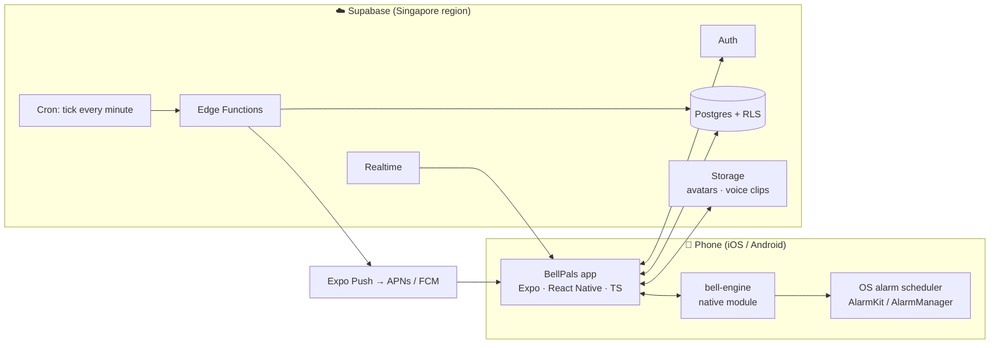
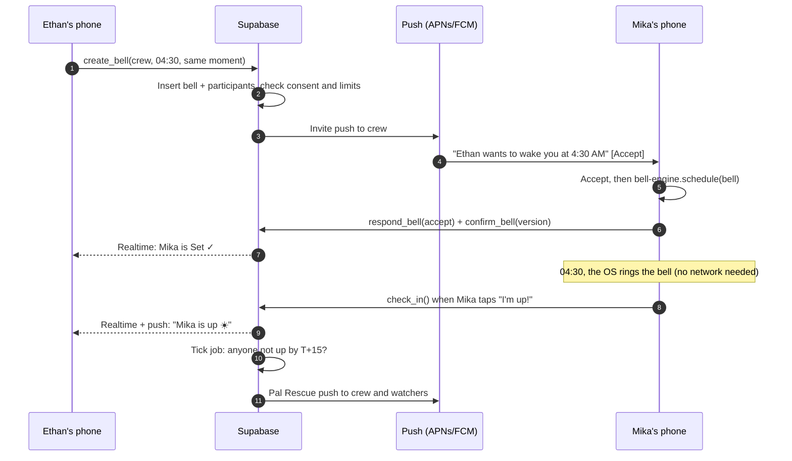
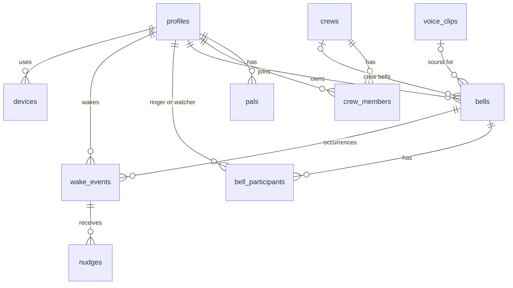

# BellPals — Technical Architecture

| | |
|---|---|
| **Version** | 0.1 (proposed; confirmed after the Phase 0 spike) · 30 Sep 2026 |
| **Related** | [PRD](PRD.md) · [Roadmap](ROADMAP.md) · [Design brief](DESIGN.md) |

---

## 1. Architecture principles

1. **The phone rings without us.**
   - Once a bell is accepted, the phone's OS alarm scheduler owns it.
   - Nothing else is needed at ring time: no network, no server, no JavaScript runtime.
2. **The server orchestrates the social layer**: who's invited, who's set, who's up, who needs rescuing.
   - It works out ring times from the schedule rather than waiting for phones to report.
   - This matters because iOS may not give our app any runtime when an alarm fires.
3. **Honest state.** A ringer is *Set ✓* only after their phone confirms. We never assume.
4. **Native where it matters, cross-platform everywhere else.** The alarm engine is Swift/Kotlin; everything else is TypeScript.
5. **Time is hard, so be explicit.**
   - Store UTC instants plus IANA time zones.
   - Every shared bell declares its time mode.

## 2. Recommended stack *(Decision D5)*

| Layer | Choice | Why |
|---|---|---|
| App | **Expo** (React Native, TypeScript, New Architecture) + Expo Router | One codebase for iOS and Android · fast iteration · OTA updates for JS · EAS cloud builds (building doesn't need a Mac) |
| Alarm engine | Local Expo module **`bell-engine`**: Swift (AlarmKit) + Kotlin (AlarmManager) | Alarms need first-class native APIs. The module is small and fully under our control |
| iOS extension | Widget extension for AlarmKit Live Activities, added via a config plugin (e.g. `@bacons/apple-targets`) | AlarmKit expects one when bells use a countdown (snooze) presentation |
| App state | TanStack Query (server cache) + Zustand (local UI state) | Simple and well known |
| Backend | **Supabase**: Postgres + RLS · Auth · Realtime · Storage · Edge Functions (Deno/TS) · Cron | Relational data fits pals, crews and bells · RLS for privacy · Realtime for the Wake Board · Singapore region |
| Push | Expo Push Service → APNs / FCM | Simplest start. Verify iOS *time-sensitive* and category-action support, and fall back to direct APNs/FCM if it's missing |
| Links | Universal Links / App Links on the BellPals domain + a static landing page | Invite links |
| Monitoring | Sentry (crashes) · PostHog (analytics, feature flags) | Free tiers to start |
| Payments (later) | RevenueCat | Cross-platform subscriptions |
| CI/CD | GitHub Actions + EAS Build / Submit / Update | |

**Alternatives considered**

| Option | Pros | Cons | Verdict |
|---|---|---|---|
| Fully native (Swift + Kotlin) | Maximum control and platform feel | Two codebases, roughly 1.7–2× the effort for the social layer | Only revisit if Phase 0 shows React Native getting in the way |
| Flutter | Single codebase, good performance | Still needs the same native alarm modules. No advantage over Expo here | Viable, not preferred |
| Firebase instead of Supabase | Mature, and FCM is built in | Document store is awkward for relational pal/crew/bell data and its rules | Viable alternative |

Existing open-source modules such as `react-native-nitro-ios-alarm-kit` (iOS-only, bundled sounds only) and `expo-alarm` are useful references for the spike. We still own our module, because alarms *are* the product.

## 3. System overview



## 4. Bell engine (native alarm module)

The only part of the app that talks to OS alarm APIs. It's a thin TypeScript API over Swift and Kotlin:

```ts
type BellSchedule =
  | { kind: 'once'; at: string }                                             // ISO instant (UTC)
  | { kind: 'weekly'; hour: number; minute: number; weekdays: Weekday[] };   // local wall-clock time on the device

interface NativeBell {
  id: string;                       // bell id (+ occurrence suffix for one-off backups)
  schedule: BellSchedule;
  title: string;                    // short: shown on Lock Screen / Dynamic Island
  sound: { type: 'builtin'; name: string } | { type: 'file'; path: string };
  snoozeMinutes: number | null;     // null = no snooze → secondary button is "I'm up"
  backupAfterMinutes: number | null;
}

BellEngine.getAuthorization(): Promise<'authorized' | 'denied' | 'notDetermined'>;
BellEngine.requestAuthorization(): Promise<'authorized' | 'denied'>;
BellEngine.schedule(bell: NativeBell): Promise<void>;
BellEngine.cancel(id: string): Promise<void>;
BellEngine.list(): Promise<ScheduledBell[]>;
BellEngine.health(): Promise<HealthReport>;  // permissions, exact alarms, full-screen intent, battery optimisation, time zone
BellEngine.addListener('bellEvent', (e: { id: string; type: 'stopped' | 'snoozed' | 'imUp'; at: string }) => void);
```

### iOS (AlarmKit, iOS 26+)

- **Authorisation.** Call `AlarmManager.shared.requestAuthorization()`. `NSAlarmKitUsageDescription` must be in `Info.plist`, otherwise the app can't schedule alarms.
- **Schedules.**
  - One-time bells use `Alarm.Schedule.fixed(date)`.
  - Local-time repeating bells use `.relative(.init(time: .init(hour:minute:), repeats: .weekly(days)))`, which follows the phone's time zone.
- **Presentation.**
  - The alert is built with `AlarmPresentation.Alert(title:stopButton:secondaryButton:secondaryButtonBehavior:)`.
  - The secondary button is *either* `.countdown` (snooze / "repeat", using `postAlert`) *or* `.custom` (opens the app, i.e. "I'm up").
  - `AlarmAttributes` carries the tint colour and metadata. The system forwards the alert to a paired Apple Watch.
- **Intents.**
  - `stopIntent` records "stopped" (best-effort) and posts a "Tap to check in" notification.
  - `secondaryIntent` opens the check-in screen, or records a snooze.
- **Widget extension (required).** Apple says AlarmKit expects a widget extension when an app supports a countdown presentation. Without one, the system may dismiss alarms and fail to alert.
- **State stream.** `alarmManager.alarmUpdates` is used only while the app is running. **Don't rely on it for real-time server updates**, because developers report delivery is deferred while the app is suspended on iOS 27 betas.
- **Sounds.**
  - Bundled `.caf`/`.wav`/`.aiff` tones work.
  - **The spike checks whether a file written at runtime** (a downloaded voice clip, e.g. in `Library/Sounds`) can be the alarm sound. The answer decides the VOICE-2 strategy.
- **Scheduling without opening the app.** Phase 0 tests three opportunistic paths:
  - (a) a notification action handled in the background
  - (b) a silent push
  - (c) `BGAppRefreshTask`

  The guaranteed path is the user tapping Accept.
- **Known developer reports to test against** (status on release builds unknown):
  - alarms firing late (seen on iOS 26 betas)
  - alarms not firing while the screen is on or the app is in the foreground
  - alarms not firing when a foregrounded app is in landscape
  - iOS 27 beta regressions: deferred `alarmUpdates`, stale re-presentation hours later, audio without UI during Focus

### Android (Android 10+, target API 36)

- **Scheduling.**
  - `AlarmManager.setAlarmClock(AlarmClockInfo(triggerAt, showIntent), operation)` is exact, allowed during Doze, and shows the alarm icon in the status bar.
  - Repeating bells schedule their next occurrence when one fires.
- **Permissions and Play declarations.**
  - `USE_EXACT_ALARM`: for apps whose core function is an alarm clock; needs a Play declaration.
  - `USE_FULL_SCREEN_INTENT`: auto-granted to alarm and calling apps on Android 14+ with a Play declaration. Check `NotificationManager.canUseFullScreenIntent()`.
  - `POST_NOTIFICATIONS`: runtime prompt on Android 13+.
  - `FOREGROUND_SERVICE` + `FOREGROUND_SERVICE_SYSTEM_EXEMPTED`: the `systemExempted` type is allowed for apps holding an exact-alarm permission, with `mediaPlayback` as the fallback.
  - `RECEIVE_BOOT_COMPLETED`, `WAKE_LOCK`, `VIBRATE`.
- **Ring path.**
  1. `BroadcastReceiver` starts `RingingService`, a foreground service.
  2. The service plays audio with `AudioAttributes.USAGE_ALARM` (alarm volume, ignores silent mode), vibrates, and holds a wake lock.
  3. It posts a notification with a `fullScreenIntent`, which opens `RingingActivity` (`setShowWhenLocked`, `setTurnScreenOn`).
- **Surviving reboots and changes.** Reschedule on:
  - `BOOT_COMPLETED` and `LOCKED_BOOT_COMPLETED`. Keep bells in **device-protected storage** so they ring after a reboot even before the phone is unlocked.
  - `TIME_SET`, `TIMEZONE_CHANGED`, `MY_PACKAGE_REPLACED`
  - changes to the exact-alarm permission
- **Remote scheduling.** High-priority FCM data messages can wake the app to schedule a bell (used for trusted-pal auto-accepts). This doesn't work after the user force-stops the app.
- **Makers that kill background apps.** Detect the manufacturer and deep-link to the right settings screen, with per-brand instructions (see dontkillmyapp.com).
- **Native persistence.** The Kotlin side keeps its own small store of scheduled bells, because JS may not be running when an alarm fires or the phone reboots.

## 5. Scheduling and sync

- The **server** is the source of truth for bell definitions and who's participating.
- The **phone** is the source of truth for what's actually scheduled on it.
- `bells.version` increments on every edit. `bell_participants.confirmed_version` records what the ringer's phone has scheduled. A ringer is **Set ✓** when `confirmed_version = version`.



**Ways a bell reaches a phone** (most reliable first):
1. The user taps **Accept**, in the app or from a notification that opens it, and the bell is scheduled immediately.
2. A notification action is handled in the background, scheduling the bell without opening the app. Phase 0 checks this on iOS.
3. A trusted-pal auto-accept arrives as a data/silent push and the bell is scheduled in the background. This is fairly dependable on Android and opportunistic on iOS.
4. The **reconcile loop** runs on every launch, foreground and background refresh:
   ```text
   server = my upcoming accepted ringer bells
   local  = BellEngine.list()
   schedule(server − local); cancel(local − server); reschedule(version changed)
   confirm_bell(...) for each change; upload device health + time zone
   ```
5. **Safety net:** reminder pushes at T-12h and T-1h to ringers who aren't confirmed.

**Edits and cancellations** bump the version, send a push and trigger a reconcile. A phone that never gets runtime still rings at the old time, and the Wake Board shows *Update pending*, so the confusion is visible.

**Time modes**

| Mode | Stored as | Phone schedules | Example |
|---|---|---|---|
| Same moment | `at` (UTC instant) | A fixed instant | Flight day: 04:30 SGT = 21:30 London the day before |
| Same local time | `local_time` + `weekdays` (or `local_date`) | A local wall-clock time that follows the phone's time zone | Run club at 06:00 wherever you are |

- The server computes each ringer's expected `ring_at` from the time zone their phone last reported. If that zone looks stale (they travelled and haven't opened the app), escalation goes *soft*: no Pal Rescue alerts, so there are no false alarms.
- **DST:** local-time bells follow the wall clock. A skipped time (spring forward) rings at the next valid minute, and a repeated time (fall back) rings once. Covered by unit tests with DST fixtures.
- **Repeating bells:**
  - The main bell uses the platform's repeating schedule.
  - **Backup Bells are one-time alarms** for the next few occurrences, refreshed on each reconcile, because they're cancelled per occurrence on check-in.

## 6. Wake status and escalation

- `wake_events` holds one row per ringer per occurrence. The tick job creates them about 36 h ahead.
- **Check-in:**
  - `check_in()` is idempotent.
  - Offline check-ins queue with their original timestamp and sync later.
- **Device events** (`stopped`, `snoozed`) are best-effort. They're reliable on Android, and on iOS only when AlarmKit intents run.
- **Tick job**, every minute (Supabase Cron → Edge Function):
  1. Create upcoming occurrences.
  2. Remind unconfirmed ringers at T-12h and T-1h.
  3. At **T + grace** (default 15 min) with no check-in, mark `not_up` and send Pal Rescue pushes to watchers and the crew.
  4. At **T + 60 min**, mark `slept_through` and update streaks.
- **Event-driven:** a check-in triggers "Mika is up", and the last ringer's check-in triggers "Everyone's up 🎉".
- The **Backup Bell is local to the phone.** It's scheduled on accept and cancelled on check-in, so it works offline.

## 7. Data model



| Table | Key columns |
|---|---|
| `profiles` | `id` (= auth user) · `username` (unique, case-insensitive) · `display_name` · `avatar_url` / `avatar_emoji` + `avatar_color` · `time_zone` (IANA) · `incoming_policy` (`pals`/`trusted`/`nobody`) · `quiet_start`, `quiet_end` · `deleted_at` |
| `pal_requests` | `from_id` · `to_id` · `status` (`pending`/`accepted`/`declined`/`cancelled`) |
| `pals` | `user_id` · `pal_id` · `trusted`. Two rows per friendship, so each side has its own settings |
| `blocks` | `blocker_id` · `blocked_id` |
| `crews` / `crew_members` | `name`, `emoji`, `color`, `owner_id` / `crew_id`, `user_id`, `role` |
| `bells` | `owner_id` · `kind` (`mine`/`pal`/`crew`) · `crew_id?` · `label`, `emoji` · `time_mode` (`instant`/`local`) · `at?` · `local_time?`, `local_date?`, `weekdays` (bitmask, 0 = once) · `sound_id`, `voice_clip_id?` · `snooze_minutes` · `backup_after_min?` · `rescue_after_min` · `status` · `version` |
| `bell_participants` | `bell_id` · `user_id` · `role` (`ringer`/`watcher`) · `status` (`invited`/`accepted`/`declined`/`left`) · `confirmed_version?` · `confirmed_at?` · `device_id?` |
| `wake_events` | `bell_id` · `user_id` · `ring_at` · `state` (`scheduled`/`ringing`/`snoozed`/`up`/`not_up`/`slept_through`) · `snooze_count` · `up_at?` · `emoji?`. Unique on (`bell_id`, `user_id`, `ring_at`) |
| `nudges` | `wake_event_id` · `from_id` · `created_at` |
| `voice_clips` | `owner_id` · `storage_path` · `duration_ms` · `format` · `delete_after` |
| `devices` | `user_id` · `platform` · `push_token` · `app_version`, `os_version` · `time_zone` · `health` (jsonb) · `last_seen_at` |
| `invite_links` | `code` · `kind` (`pal`/`crew`/`bell`) · `target_id` · `created_by` · `expires_at` · `uses` |
| `reports` | `reporter_id` · `target_type`, `target_id` · `reason` · `status` |

## 8. Server API

Writes go through **Postgres functions (RPC, `security definer`)** that enforce the business rules (consent, blocks, rate limits), not direct table writes. Reads use RLS-protected selects plus Realtime subscriptions.

| Function | Purpose |
|---|---|
| `create_bell(payload)` | Create the bell and participants · auto-accept trusted pals · enforce policy, blocks and limits · queue invite pushes |
| `respond_bell(bell_id, accept)` | Accept or decline |
| `confirm_bell(bell_id, version, device_id)` | Phone confirms scheduling (Set ✓) |
| `update_bell` / `cancel_bell` / `leave_bell` | Edits (bump `version`) and exits |
| `check_in(bell_id, ring_at, emoji?)` | I'm up! Idempotent, and accepts offline timestamps within bounds |
| `report_bell_event(bell_id, ring_at, type)` | Best-effort `stopped` / `snoozed` |
| `send_nudge(wake_event_id)` | Rate-limited, participants only, only inside the wake window |
| `send_pal_request` / `respond_pal_request` / `set_trusted` / `block_user` | Pals |
| `create_crew` / `add_crew_members` / `leave_crew` | Crews |
| `create_invite_link` / `redeem_invite` | Invite links |
| `search_profiles(query)` | Minimal public fields only, so profiles can't be enumerated |
| Edge Function `push-dispatch` | Sends queued pushes, handles receipts and dead tokens |
| Edge Function `tick` | The per-minute scheduler (§6) |
| Edge Function `voice-upload` | Signed upload URL, format check/transcode, retention |
| Edge Function `delete-account` | Full account deletion using the service role |

## 9. Push notifications

| Type | Sent to | iOS interruption level | Actions |
|---|---|---|---|
| Bell invite | Ringers | Active (passive in quiet hours) | Accept · Decline |
| Auto-accepted bell | Ringer | Passive | View · Leave |
| Bell updated / cancelled | Participants | Active + data | — |
| Not-confirmed reminder | Ringer | Active | Confirm |
| "Mika is up" / "Everyone's up" | Watchers + crew (per settings) | Active / passive | View |
| Pal Rescue: "Jon isn't up yet" | Watchers + crew | **Time-sensitive** | Nudge · View |
| Nudge | Ringer | **Time-sensitive**, with sound | I'm up! |
| Pal request | Recipient | Active (passive in quiet hours) | Accept · Decline |

What this needs:
- **iOS:** the *Time Sensitive Notifications* capability, with notification categories registered at launch.
- **Android notification channels:**
  - *Bell invites*
  - *Wake updates*
  - *Rescue & nudges* (high importance)
  - *Ringing* (alarm category, max importance)

## 10. Security and privacy

- **RLS on every table:**
  - Profiles: your own row is fully visible; pals see display fields; everyone else only via `search_profiles`.
  - Pals, requests and blocks: only the two users involved.
  - Crews: members only.
  - Bells, participants, wake events and nudges: that bell's participants only.
- **Storage:** private buckets. Voice clips are served via short-lived signed URLs, to participants only.
- **Abuse controls:** rate limits in RPCs, blocks enforced in every function that connects two users, and nudges allowed only inside the wake window.
- **Secrets:** never in the repo. They live in EAS secrets, GitHub Actions secrets and Supabase secrets.
- **Retention:**
  - Voice clips are deleted 30 days after the bell ends.
  - Old wake events are aggregated after 180 days, keeping streak counters.
  - Account deletion cascades.
- **Region:** Supabase Singapore (`ap-southeast-1`).
- **Tests:** a pgTAP RLS suite, e.g. "user A can't read user B's bells", "a blocked user can't send bells".

## 11. Phase 0 reliability spike

**Goal:** prove BELL-3 on real devices before building anything on top of it.

**Devices:**
- iPhones: one on iOS 26.x and one on iOS 27.x. With a single iPhone, run iOS 26 first, then upgrade.
- Android phones: a Google Pixel (stock Android), a Samsung Galaxy, and a Xiaomi/Redmi or Oppo (aggressive battery management).

| # | Scenario | Gate |
|---|---|---|
| 1 | Locked, screen off, ringer on | Must |
| 2 | Silent / mute switch on | Must |
| 3 | Focus / Do Not Disturb / Sleep Focus on | Must |
| 4 | App swiped away / force-quit before ring time | Must |
| 5 | Phone rebooted after scheduling, not unlocked | Must (Android) · verify on iOS |
| 6 | No network (airplane mode) | Must |
| 7 | Screen on, BellPals in the foreground | Must |
| 8 | Screen on, another app in the foreground, portrait **and** landscape (e.g. video) | Must |
| 9 | Low Power Mode / Battery Saver, idle ≥ 6 h (Android: forced Doze via `adb`) | Must |
| 10 | Bluetooth headphones connected | Should |
| 11 | Time zone changed between scheduling and ring | Must |
| 12 | DST transition (set phone to a DST zone) | Should |
| 13 | Weekly repeating bell rings on the correct days | Must |
| 14 | Snooze re-rings after N min; snooze gets reported | Must |
| 15 | Backup Bell rings when there's no check-in, and is cancelled after check-in | Must |
| 16 | Bundled custom sound plays | Must |
| 17 | **Downloaded voice clip plays as the alarm sound** | Decides VOICE-2 |
| 18 | **Scheduled from a notification action without opening the app** | Decides the accept UX |
| 19 | **Scheduled from a silent/data push with the app backgrounded or killed** | Decides trusted auto-accept |
| 20 | 20+ bells scheduled at once | Should |
| 21 | OS update between scheduling and ring | Watch item |
| 22 | Android maker battery settings left at defaults | Must (with the guided fix) |
| 23 | iOS 27 separate alarm volume: confirm AlarmKit bells follow the alarm volume | Should |

**Pass** means all of these:
- it rings within ±60 s
- it's audible at the expected volume
- the UI appears
- Stop and Snooze work
- the check-in path works

**Output:** a reliability report (pass/fail grid with notes) → ADR-003 → go/no-go at M0.

## 12. Project structure (proposed)

```text
bellpals/
├─ app/                    # Expo Router routes (screens)
├─ src/
│  ├─ features/            # bells, pals, crews, wake-board, onboarding, settings
│  ├─ components/          # design-system components
│  ├─ theme/               # tokens (from Figma variables)
│  ├─ lib/                 # supabase client, push, analytics, time maths
│  └─ state/               # TanStack Query hooks, Zustand stores
├─ modules/
│  └─ bell-engine/         # Expo module: ios/ (Swift, AlarmKit) · android/ (Kotlin) · src/ (TS API)
├─ targets/
│  └─ widgets/             # iOS widget extension (AlarmKit Live Activities)
├─ supabase/
│  ├─ migrations/          # schema, RLS, RPC functions
│  ├─ functions/           # Edge Functions (Deno/TS)
│  └─ tests/               # pgTAP tests
├─ e2e/                    # Maestro flows
├─ docs/                   # PRD, roadmap, design, architecture, ADRs
└─ .github/workflows/      # CI
```

## 13. Environments, CI/CD and releases

- **Environments:**
  - **local:** Supabase CLI stack + Expo dev client
  - **staging:** Supabase staging project + EAS `preview` channel + TestFlight / Play internal testing
  - **production**
- **On every PR:** typecheck, lint, format check, Jest unit tests, Supabase migrations + RLS tests (`supabase test db`), `expo-doctor`.
- **On merge:** EAS Update to the `preview` channel for JS-only changes, and an EAS Build when the native fingerprint changes.
- **Release:** tag → EAS Build (production) → EAS Submit to App Store Connect / Play Console.
- **OTA policy:**
  - EAS Update ships JS/UI fixes only.
  - Any change to `modules/bell-engine`, permissions or native config needs a store release.
  - `runtimeVersion` uses the `fingerprint` policy, so OTA updates never reach an incompatible binary.

## 14. Testing strategy

| Layer | Tooling | Focus |
|---|---|---|
| Unit | Jest | Time maths (zones, DST, time modes), schedule computation, state logic |
| Database | pgTAP via Supabase CLI | RLS isolation · RPC rules (consent, blocks, limits) · tick job |
| Native | XCTest · JUnit + Robolectric | Schedule computation, persistence, reboot rescheduling |
| End-to-end | Maestro (simulators/emulators) | Onboarding, create bell, accept invite with two test accounts |
| Device reliability | Manual matrix (§11) | Must-pass subset on every release candidate; full matrix on major OS updates |
| Beta telemetry | "It didn't ring" reports + health pings | Real-world reliability by OS, device and app version |

## 15. Observability

- **Sentry:** JS and native crashes, release health.
- **PostHog:** activation and invite funnels, retention, feature flags.
- **Reliability dashboard** (SQL on Supabase):
  - % of ringers Set ✓ by T-1h
  - check-in latency distribution
  - Pal Rescue rate
  - "didn't ring" reports by OS, device and version
- **Alerts:** a spike in "didn't ring" reports or in unconfirmed ringers notifies us.

## 16. Running costs (approximate, USD, Sep 2026; verify when signing up)

| Item | Cost | When |
|---|---|---|
| Apple Developer Program | $99 / year | Phase 0 |
| Google Play Console | $25 one-time | Phase 0 |
| Domain (e.g. `bellpals.app`) | ~$15–25 / year | Phase 0–2 |
| Supabase | Free → Pro ~$25 / month | Pro from beta or launch |
| Expo EAS | Free tier → ~$19 / month if more builds are needed | As needed |
| Sentry · PostHog | Free tiers | Phase 1 / 3 |
| Static hosting for links and landing page | Free tier | Phase 2 |
| Sound design / licences | $0–500 one-off | Phase 1–3 |
| Legal review (privacy policy, terms) | Varies | Phase 3 |

**Year 1 infrastructure: roughly US$400–1,000**, excluding design, legal and your time.

## 17. Decisions to record (ADRs in `docs/adr/`)

- ADR-001 App framework (Expo)
- ADR-002 Backend (Supabase)
- ADR-003 Alarm engine and sound strategy (after the spike)
- ADR-004 Time modes and DST rules
- ADR-005 Push provider
- ADR-006 Analytics and privacy
