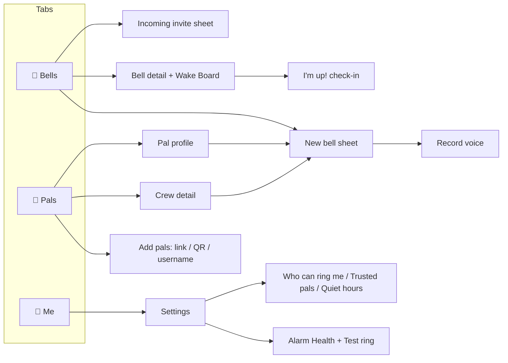
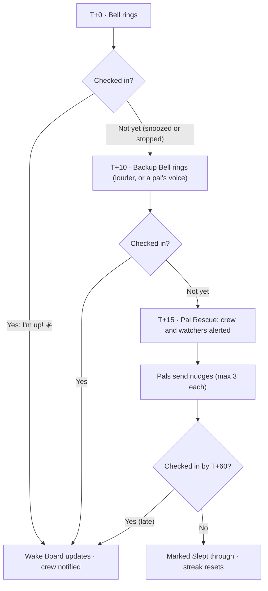

# BellPals — Design Brief

| | |
|---|---|
| **Version** | 0.1 (draft) · 30 Sep 2026 |
| **Purpose** | The UX and visual brief for designers (designmagic) and the implementation reference for developers |
| **Related** | [PRD](PRD.md) · [Roadmap](ROADMAP.md) · [Architecture](ARCHITECTURE.md) |

---

## 1. Design goals and principles

BellPals should feel like **sunrise with friends**: warm, playful and reassuring. It's used at the two most fragile moments of the day, so it also has to be calm at night and dead simple at dawn.

| Principle | What it means in the UI |
|---|---|
| **Groggy-proof** | Wake-time screens have one primary action, targets ≥ 64 pt, no typing, and work one-handed |
| **Night-friendly** | Dark surfaces for bedtime and wake-time screens. No bright white flashes at 5 a.m. |
| **Trust is visible** | Always show whether a bell is really set (Set ✓), when it'll ring *for me*, and whether my phone is healthy |
| **Social presence** | Faces everywhere: avatars on bells, a live Wake Board, "Mika is up ☀️" moments |
| **Kind accountability** | Snoozes and misses are shown with humour, never shame |
| **Consent is obvious** | Every incoming bell shows who, when (in my time) and why, with Accept/Decline equally easy |

## 2. Platform constraints designers must know

These shape what we can design, especially the ringing moment.

**iOS (AlarmKit, iOS 26+)**
- The **alarm alert is drawn by the system** on the Lock Screen, in the Dynamic Island, in StandBy and on a paired Apple Watch. We don't control its layout.
- We *can* set:
  - a short **title** (≈ 15 characters fits the Dynamic Island)
  - a **Stop** button and **one** secondary button (label, text colour, SF Symbol)
  - a **tint colour**
  - the **sound**

  Design the bell label and emoji to read well there, e.g. "✈️ Flight Day".
- The secondary button can be **Snooze** (a countdown) *or* **I'm up** (opens the app), but not both. Proposal:
  - bells with snooze → *Stop* + *Snooze*
  - no-snooze bells (like flight day) → *Stop* + *I'm up*
- Snooze countdowns show as a **Live Activity** (Lock Screen and Dynamic Island), which we design.
- Our own "wake-up" screen only appears **after the user opens the app**, so the in-app check-in has to feel like a continuation of the system alarm.
- OS permission prompts are system UI; we only write the purpose strings (see §9).

**Android**
- The ringing screen is **fully ours**: a full-screen activity shown over the lock screen.
- When the phone is in use, a heads-up notification with *Stop / Snooze / I'm up* appears instead.
- Some phone makers (Xiaomi, Oppo, Huawei, some Samsung settings) kill background apps, so a guided **"Keep BellPals awake"** flow per brand is part of onboarding and Alarm Health.

**Notifications (both)**
- Title, body, up to ~3 actions, optional image.
- On iOS, **interruption levels** matter:
  - *passive* for requests during quiet hours
  - *active* by default
  - *time-sensitive* for nudges and Pal Rescue

## 3. Information architecture

Three tabs keep the app simple. The Wake Board is contextual: it opens from a bell, a notification, or a live banner during a wake window.

- **Bells**, the home tab: the next bell, upcoming bells, invites, and a live Wake Board banner during wake windows. There's a floating **+ New bell** button.
- **Pals**: crews, pals, requests, and adding pals.
- **Me**: profile, streaks and settings.

## 4. Key flows

**F1 · Onboarding.** Value intro (3 cards) → sign in → name, avatar, @username → *"How BellPals rings"* primer → OS alarm permission → notifications primer → OS prompt → (Android) keep-awake guide → create first bell → **Test ring in 1 min** → invite pals → Bells tab.
*From an invite link:* sign in → profile → straight to the invite. Permissions are asked when accepting.

**F2 · Create a Crew Bell** (target: under 1 minute):
1. **+** → *Who's waking up?* (Me · A pal · A crew)
2. Pick a crew
3. Time and date
4. Repeat
5. Label and emoji
6. Sound (a tone, or *Record your voice*)
7. *Wake rules*: collapsed defaults for snooze, Backup Bell and rescue timing
8. The time mode only appears if the crew spans time zones, with a preview of everyone's ring time
9. **Send** → Bell detail, with everyone at *Invited*

**F3 · Accept an invite.**
1. A push arrives: "Ethan wants to wake you at 4:30 AM for ✈️ Flight Day" [Accept] [Decline].
2. Accept → the bell is scheduled on this phone → **Set ✓**, with a haptic.
3. If the app opens, the invite sheet shows who else is in, your local time, the sound preview and the wake rules.

**F4 · Wake up and Pal Rescue.** All times are measured from ring time *T* and can be tuned per bell.

**F5 · Send a Voice Bell.**
1. New Pal Bell → Sound → **Record your voice**
2. Hold to record (≤ 30 s)
3. Play back / re-record
4. Send
5. The pal accepts, then wakes to your voice. If the platform fallback applies, the clip plays when they check in.

**F6 · Consent settings.** Me → *Who can ring me* (Any pal / Trusted only / Nobody) → Trusted pals list → Quiet hours → Blocked users.

## 5. Screen specs

Each screen lists content from top to bottom. States to design for every list: **empty**, **loading**, **error/offline**.

**S1 · Welcome (3 cards).** Covers "Alarms, but with your pals", "See who's up", and "Nobody gets left asleep". CTA: *Get started*.

**S2 · Sign in.** Apple, Google and email-code buttons. Legal links.

**S3 · Profile setup.** Avatar (photo, or emoji plus colour), display name, @username with a live availability check.

**S4 · Permission primers and Test ring.**
- One illustrated card per permission, each with a *why* line, then the OS prompt.
- The Alarm Health summary shows ✓/⚠ rows.
- A *Test ring in 1 min* button with the instruction "Lock your phone and wait".

**S5 · Bells (home).**
- Header: greeting, and a health dot that goes amber when something needs fixing.
- An **invites banner**, if there are any.
- A **next bell hero card**:
  - large time and countdown ("in 7 h 12 m")
  - label and emoji
  - avatar stack of ringers with their Set ✓ status
- **Upcoming list**, grouped Today / Tomorrow / Later. Each row shows time, label, type chip (Mine / Pal / Crew), avatars and a toggle.
- The **+** button.
- During a wake window, a live **Wake Board banner** ("4 of 6 up").

**S6 · New bell sheet.** A stepped bottom sheet (see F2):
- **Big time picker**: a wheel or dial with large numerals.
- A **repeat** day-chip row.
- A **sound** row with a preview button.
- *Wake rules* as an expandable section.
- The primary CTA changes with context: *Set bell* / *Send to Mika* / *Send to crew*.

**S7 · Incoming invite sheet.**
- Sender avatar, and the line "Ethan wants to wake you".
- The label.
- **Your ring time**, huge, with the date. The sender's time appears too if the time zones differ.
- Who else is in, a sound preview, and the wake rules summary.
- **Accept** and **Decline** as equal-weight buttons, plus "Always accept from Ethan (make Trusted)".

**S8 · Ringing.**
- *Android*, full screen on a night background:
  - bell label and emoji
  - huge current time
  - sender or crew avatars ("Your crew is waking up too")
  - a big **I'm up!** button
  - a secondary **Snooze** button (if allowed) and a small *Stop*
  - a voice-bell indicator ("🎙 Ethan's voice")
- *iOS*: design the Live Activity for the snooze countdown, plus the button labels, tint and title.

**S9 · I'm up! check-in.**
- One giant button, plus an optional emoji row (☀️ 😴 💪 🥱 ✈️).
- After the tap, a sunrise animation and "You're up at 4:31, on the first ring 🏆". This then leads to the Wake Board.
- If a voice clip is attached and hasn't played yet, it plays here.

**S10 · Bell detail and Wake Board.**
- Header: label, time (mine and others'), repeat, and the crew.
- **Wake Board**: a grid of avatars, each with a state ring and label (see §6).
- A **Nudge** action on anyone who isn't up yet.
- Crew streak, if the bell repeats.
- Owner actions: edit, cancel, invite more. Everyone gets *Leave*.

**S11 · Pals.**
- Crews as a horizontal row of cards (emoji, name, member avatars, next bell).
- Pal requests.
- The pal list: avatar, name, @username, Trusted badge, their next shared bell.
- **Add pals**: share invite link, show my QR, scan QR, search @username.

**S12 · Crew detail.** Name and emoji, members (manageable by the owner), crew bells, crew streak, *New crew bell*, invite link, leave crew.

**S13 · Record voice.** A hold-to-record button with a waveform and a 30 s ring timer. Play, re-record, use. A tip line: "Say their name — it works better 😉".

**S14 · Me and Settings.**
- Profile, streak stats.
- Settings: Alarm Health, default sound and snooze, *Who can ring me*, Trusted pals, Quiet hours, Notifications, Blocked, Privacy and terms, Delete account.

## 6. Wake Board states

Status is never shown by colour alone. Every state has an icon *and* a label.

| State | Meaning | Visual | Label copy |
|---|---|---|---|
| Invited | Hasn't responded | Grey dashed ring, ⏳ | "Invited" |
| Declined | Said no, or left | Faded avatar, ✕ | "Can't make it" |
| Set ✓ | Scheduled on their phone (confirmed) | Solid ring, small ✓ | "Set for 4:30" |
| Update pending | Accepted, but their phone hasn't confirmed the latest version | Amber ring, ! | "Needs to open BellPals" |
| Ringing | Within the first minutes after ring time | Pulsing ring | "Ringing…" |
| Snoozed ×n | Device reported snoozes (best-effort on iOS) | 💤 badge with count | "Snoozed ×2" |
| Up | Checked in within grace | Green ring plus time | "Up at 4:31 ☀️" |
| Up (late) | Checked in after grace | Green ring plus "late" tag | "Up at 4:52" |
| Not up yet | Past grace, no check-in | Red ring plus **Nudge** button | "Not up yet" |
| Slept through | Wake window ended, no check-in | Red ring, 😴 | "Slept through" |

## 7. Visual direction

Three directions to choose from *(Decision D8)*. **Recommendation: A.**

| | A · Sunrise Social ⭐ | B · Calm Night | C · Loud & Loveable |
|---|---|---|---|
| Mood | Warm, optimistic, friendly | Soft, meditative, sleep-wellness | Bold, Gen-Z, sticker-energy |
| Colour | Deep night navy + amber→coral sunrise accents + friendly pal colours | Muted indigo and lavender, soft gradients | Punchy primaries, thick outlines |
| Type | Rounded display (e.g. Nunito ExtraBold) + system UI font | Elegant serif display (e.g. Fraunces) + system | Chunky grotesk (e.g. Space Grotesk Bold) + system |
| Risk | Could feel generic if not crafted | Less playful and less "social" | Too loud at 5 a.m. |

**Proposed tokens for Direction A** (starting point for designers; final values come from Figma):

| Token | Value | Use |
|---|---|---|
| `night.950` | `#070A1C` | Ringing background |
| `night.900` | `#0B1026` | Dark background |
| `night.800` | `#151B3B` | Dark surfaces and cards |
| `night.700` | `#222A55` | Dark elevated surfaces and borders |
| `dawn.50` | `#FFF8F0` | Light background |
| `dawn.100` | `#FCEBD9` | Light tinted surfaces |
| `ink.900` / `ink.500` | `#1B1F3B` / `#5B6180` | Text on light (5.7:1 for secondary) |
| `mist.100` / `mist.400` | `#F4F2FF` / `#A6ACD0` | Text on dark (8.4:1 for secondary) |
| `sun.500` | `#FFB23F` | Primary accent. Use dark text on it (≈ 9:1) |
| `coral.500` | `#FF6B57` | Secondary accent, sunrise gradient end |
| `status.up` / `snoozed` / `asleep` / `alert` | `#2FBF71` / `#FFB23F` / `#8C93BD` / `#FF5A5F` | Wake states. Each also needs a darker text variant for light mode (AA) |
| Pal colours | peach `#FF8A65` · butter `#FFD166` · mint `#06D6A0` · sky `#4CC9F0` · periwinkle `#7B8CFF` · lilac `#C77DFF` · pink `#FF70A6` · lime `#9BE564` | Avatar rings and crew colours |

- **Type scale:**
  - Clock XL 88 (ringing screen), Clock L 56 (hero), Title 28, Heading 20, Body 17, Caption 13
  - Times always use **tabular numerals**
  - Body text uses the system font so Dynamic Type works well
- **Shape:** radius 12 for inputs, 16 for buttons, 24 for cards, 32 for sheets, full for chips and avatars. 4-pt spacing grid, 20 pt screen padding.
- **Depth:** soft sun-tinted glows on dark surfaces rather than heavy shadows.
- **Icons:** rounded line icons (e.g. Phosphor or Lucide), 24 px, 2 px stroke.
- **Mascot (optional):** *Bello*, a little bell with a face in sleeping, ringing and celebrating poses. It appears in empty states, onboarding and share cards.
- **App icon idea:** a bell over a sunrise gradient, with a tiny second bell (the pal) peeking in.

## 8. Sound, haptics and motion

- **Sounds:**
  - a signature two-note "bell-pal" chime
  - 8+ tones from gentle to loud
  - one extra-loud tone for Backup Bells

  Bake the **volume ramp into the audio file** (softer for the first ~10 s), because we may not be able to control ramping on iOS. Deliver the files as `.caf`/`.wav` (iOS) and `.ogg`/`.wav` (Android). Licences must cover app distribution.
- **Haptics:** a strong pattern while ringing (Android), a success tap on check-in, and a double-tap when a nudge arrives.
- **Motion:**
  - a bell wobble while ringing
  - Wake Board avatars flip to "up" with a small sunrise sweep
  - a confetti or sunrise moment for "Everyone's up"
  - with **Reduce Motion** on, everything becomes a cross-fade

## 9. Voice and tone

Warm, cheeky and short. Kind at 5 a.m. The humour punches up, never at the sleeper.

| Moment | Copy |
|---|---|
| Invite (push) | "Ethan wants to wake you at 4:30 AM for ✈️ Flight Day. You in?" |
| Accepted (to sender) | "Mika's in. 5 of 6 set for 4:30 AM." |
| Not confirmed (T-1h) | "Your 4:30 AM bell isn't set on this phone yet. Tap to confirm." |
| Someone's up | "Mika is up ☀️ First ring, too." |
| Everyone's up | "Everyone's up! ✈️ Flight Day crew 6/6. Have an amazing trip." |
| Not up yet | "Jon isn't up yet 😴 Send a nudge?" |
| Nudge received | "🔔 Priya is nudging you. Up and at 'em!" |
| Slept through | "Jon slept through this one. There's always tomorrow 🌅" |
| Empty Bells tab | "No bells yet. Set one for yourself, or wake up with your pals." |
| Empty Pals tab | "Mornings are better together. Invite your first pal." |
| iOS alarm permission string (`NSAlarmKitUsageDescription`) | "BellPals uses alarms so your bells ring even when your phone is on silent or in a Focus." |
| Notifications primer | "Know when your crew is up, and when someone needs a nudge." |
| Android keep-awake primer | "Some phones put apps to sleep to save battery. Let BellPals stay awake so your bells always ring." |

## 10. Accessibility checklist

- [ ] Text contrast ≥ 4.5:1, and ≥ 3:1 for large text and UI components, in both themes.
- [ ] Touch targets ≥ 48 pt everywhere and ≥ 64 pt on ringing and check-in screens.
- [ ] Dynamic Type / font scaling up to 200% without clipping. Clock numerals scale with a cap.
- [ ] VoiceOver/TalkBack labels for every Wake Board state, e.g. "Mika, up at 4:31 AM".
- [ ] Status is never conveyed by colour alone.
- [ ] Reduce Motion and Reduce Transparency are respected.
- [ ] Haptics can be switched off.
- [ ] Voice bells: offer text in the notification as an alternative to the audio, for deaf and hard-of-hearing users.

## 11. Design deliverables and process

| Phase | Design deliverables |
|---|---|
| **0** | Moodboards for A/B/C → pick one · low-fi wireframes for F1–F6 · clickable prototype · 5 hallway tests with friends |
| **1** | Tokens as Figma variables (light + dark) · core components · app icon v1 · sound brief |
| **2** | Hi-fi screens for pals, crews, shared bells, invites and the Wake Board · Android ringing screen · iOS Live Activity / Dynamic Island · notification copy |
| **3** | Mascot and illustrations · celebration motion · share cards · store screenshots and preview-video storyboard |

**Handoff**
- Figma file pages: *Cover · Foundations · Components · Flows · Screens · Prototype · Store assets*.
- Name components the way they'll be named in code, e.g. `BellCard` and `WakeBoardAvatar`.
- Share the Figma link. I can read frames through the Figma connector and implement them, and design tokens are exported into `src/theme/tokens.ts`.
