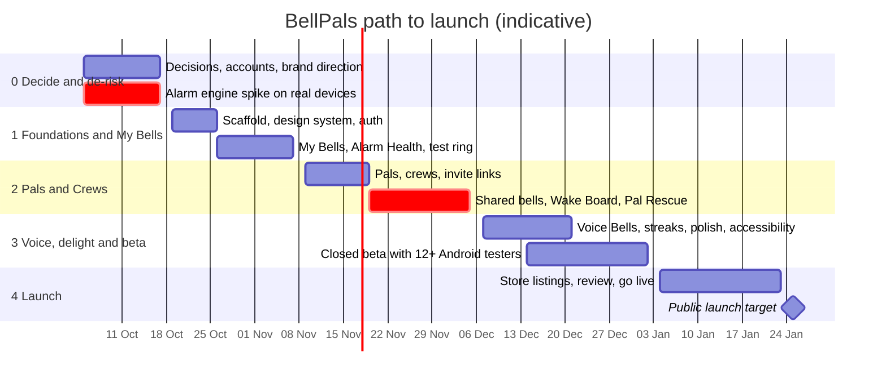

# BellPals — Roadmap

| | |
|---|---|
| **Version** | 0.1 (draft) · 30 Sep 2026 |
| **Assumes** | You plus Claude Code building at roughly 1 full-time equivalent, starting Mon 5 Oct 2026. At half-time, double the durations |
| **Related** | [PRD](PRD.md) · [Design brief](DESIGN.md) · [Architecture](ARCHITECTURE.md) · [What I need from you](WHAT_I_NEED_FROM_YOU.md) |

Each phase ends with **exit criteria** that have to be met before the next one starts. The riskiest question comes first: *will the phone actually ring?* If it won't, the social features don't matter yet.

## Timeline (indicative)

| Milestone | Target date | Meaning |
|---|---|---|
| **M0: Go / no-go** | Fri 16 Oct 2026 | Alarm engine proven on real devices; decisions made; stack confirmed |
| **M1: "I use it every day"** | Fri 6 Nov 2026 | BellPals is your only alarm for a week with zero misses |
| **M2: Friends dogfood** | Fri 4 Dec 2026 | 5–10 friends complete ≥ 10 shared bells |
| **M3: Beta complete** | Fri 1 Jan 2027 | Beta metrics hit; no P0/P1 bugs |
| **M4: Public launch** | ~Mon 25 Jan 2027 | Live on the App Store and Google Play in Singapore, ahead of Ramadan (early Feb 2027) |

---

## Phase 0: Decide and de-risk (2 weeks)

**Goal:** answer the big questions and prove the phone will actually ring.

**You**
- [ ] Answer the decisions in [WHAT_I_NEED_FROM_YOU.md](WHAT_I_NEED_FROM_YOU.md), or reply "go with the defaults".
- [ ] Create the accounts: Apple Developer, Google Play Console, Expo, Supabase. **Start the D-U-N-S number request on day 1**, because it's the slowest step.
- [ ] Check that the name is free: App Store and Play search, domain, IPOS trademark search.
- [ ] Get test devices ready: an iPhone on iOS 26/27, plus a Samsung and/or Xiaomi/Oppo Android phone.
- [ ] Pick a brand direction (A/B/C in [DESIGN.md](DESIGN.md#7-visual-direction)) or share existing brand assets.
- [ ] Run the device test matrix with the spike build. I'll give you a checklist; each run takes about 30–45 min.

**Me (Claude Code)**
- [ ] **Alarm engine spike**: a bare Expo app with native modules for:
  - iOS: AlarmKit
  - Android: `AlarmManager.setAlarmClock` + full-screen intent + foreground service
- [ ] Spike questions to answer:
  - Can a *downloaded* voice clip be the alarm sound on iOS?
  - Can we schedule a bell from a notification action or push without opening the app?
  - How do snooze and stop intents behave?
  - What happens after a reboot?
- [ ] Write the reliability report and the ADRs: framework, backend, alarm engine, time modes, push provider.
- [ ] Low-fi wireframes of the key flows (and in Figma if you want).
- [ ] Hands-on teardown of the top 3 competitors.

**Exit criteria (M0)**
- ✅ Every *must-pass* scenario in the [test matrix](ARCHITECTURE.md#11-phase-0-reliability-spike) passes on at least one iPhone (iOS 26 and 27) and two Android brands.
- ✅ Voice Bells has a known strategy: native alarm sound, or the fallback.
- ✅ Decisions answered, stack confirmed, wireframes approved.

**If the spike fails:** if AlarmKit is too unreliable on some iOS versions, the options are:
1. Launch Android first while tracking Apple's fixes.
2. Narrow the supported iOS versions.
3. Lean harder on the backup layers (Backup Bell plus time-sensitive notifications) and be upfront about limits.

We decide together at M0.

---

## Phase 1: Foundations and My Bells (3 weeks)

**Goal:** a solid solo alarm app you'd trust as your only alarm, built on the production foundations.

**Build**
- [ ] Project scaffold:
  - Expo (TypeScript, Expo Router), lint/format, unit tests
  - GitHub Actions CI
  - EAS build profiles (development / preview / production)
- [ ] Design tokens and core components: buttons, cards, time picker, avatar, status chip, sheets.
- [ ] Supabase: staging and production projects, migrations, auth (Apple, Google, email code), profiles.
- [ ] Onboarding with permission primers (ONB-1).
- [ ] **My Bells**:
  - create, edit and delete bells, with repeats, sounds and snooze
  - production-grade bell engine
  - rescheduling on reboot and time-zone change (BELL-1, 3, 4, 8, 9)
- [ ] **Alarm Health** and **Test ring** (BELL-7).
- [ ] Crash reporting (Sentry).
- [ ] Internal builds: TestFlight and Play internal testing.

**Exit criteria (M1)**
- ✅ You use BellPals as your *only* alarm for 7 days with zero misses.
- ✅ CI is green, and there are unit tests for the time maths, including DST fixtures.

---

## Phase 2: Pals and Crews (4 weeks)

**Goal:** the social core, meaning shared bells people can trust, with nobody left asleep.

**Build**
- [ ] Usernames, invite links (universal / app links on the BellPals domain), QR codes, pal requests, block (PAL-1…6).
- [ ] Crews (PAL-5).
- [ ] **Pal Bells and Crew Bells**:
  - invites, and accept/decline (including from the notification)
  - trusted pals, incoming policy, quiet hours, rate limits (SHARE-1…7)
- [ ] **Device confirmation (Set ✓)** and reminders before ring time (SHARE-5).
- [ ] Time modes and cross-time-zone display (BELL-6).
- [ ] **I'm up!** check-in and the realtime **Wake Board** (WAKE-1, 2).
- [ ] Notifications: up / everyone's up / not up yet (WAKE-3).
- [ ] **Backup Bell**, **Pal Rescue** and **Nudges** (WAKE-4, 5).
- [ ] Server: push dispatch, the per-minute "tick" job (occurrences, reminders, escalation), and RLS tests.

**Exit criteria (M2)**
- ✅ A dogfood group of 5–10 friends completes ≥ 10 shared bells.
- ✅ ≥ 90% of ringers are Set ✓ before ring time.
- ✅ No open "didn't ring" bugs.

---

## Phase 3: Voice, delight and closed beta (4 weeks, over the holidays)

**Goal:** add the emotional hook, polish, and prove it with real users.

**Build**
- [ ] **Voice Bells**: record, upload, deliver, play; report; retention (VOICE-1…4).
- [ ] Streaks (WAKE-6), the "Everyone's up 🎉" celebration and share card, empty states, mascot and illustrations, haptics and sound polish.
- [ ] Accessibility pass and copy pass.
- [ ] Product analytics (PostHog funnels) and the "It didn't ring" diagnostics (ADM-2).
- [ ] Reporting and blocking (ADM-1).
- [ ] Privacy policy and terms: I draft them, a lawyer reviews them.

**Closed beta**
- 20–50 testers across 5–10 real friend groups, via TestFlight external testing and Play closed testing.
- **At least 12 Android testers opted in for 14 continuous days.** Google requires this for personal developer accounts; organisation accounts are exempt.
- Weekly feedback survey. In-app "didn't ring" reports get triaged within 24 h.

**Exit criteria (M3)**
- ✅ Shared-bell success ≥ 80% and crash-free sessions ≥ 99.5%.
- ✅ No open P0/P1 bugs.
- ✅ Qualitative signal: most testers would be "very disappointed" to lose BellPals.

---

## Phase 4: Launch (3 weeks)

**Build and prepare**
- [ ] Store listings:
  - name, subtitle, keywords, description
  - screenshots and preview video
  - age ratings
- [ ] Apple: privacy labels, AlarmKit usage string, review notes with a demo video and a test account.
- [ ] Google: Data safety form; declarations for exact alarm, full-screen intent and the foreground-service type; target API 36.
- [ ] Landing page on the BellPals domain (a natural designmagic job), support email, social handles.
- [ ] Monitoring: Sentry alerts, reliability dashboard, an on-call rota for the first 2 weeks.

**Go live**
- Submit for review. Apple review usually takes 1–3 days, so keep buffer.
- Android staged rollout: 20% → 50% → 100%.
- Public launch in Singapore, with seeded friend groups, campus and run clubs, travel groups and short-form content.
- A "Sahur crews" campaign for Ramadan 2027 (expected to start around early February).

**Exit criteria (M4)**
- ✅ Live on both stores, dashboards green, and the support inbox monitored.

---

## After launch

| Release | Window | Themes |
|---|---|---|
| **v1.1** | Feb–Mar 2027 | Wake-up missions · morning selfies and reactions · widgets and Live Activity countdown · deferred deep links · contact discovery |
| **v1.2** | Q2 2027 | **BellPals+** subscription (RevenueCat) · sound packs · localisation (中文, Bahasa Melayu, தமிழ்) |
| **v2** | H2 2027 | Calendar-aware bells (flights, exams) · dedicated watch apps · public challenges · live wake-up calls |

---

## How we'll work together

- **Small PRs per feature.** Each PR references PRD IDs (e.g. `SHARE-5`) and includes **"How to test on your phone"** steps.
- **Builds.** Every merge produces a preview build (EAS). You install it through TestFlight or Play internal testing.
- **Bugs and feedback** go into GitHub Issues. I pick them up in the next session.
- **Weekly check-in:** a demo, decisions needed, and next week's plan.
- **Division of labour.** I write and test the code, CI, database and docs. I can't physically hear an alarm ring from the cloud, so **on-device testing is your part**. I'll keep it quick with scripted checklists.

## What could move the dates

- **Slower accounts.** The D-U-N-S number and Apple organisation enrolment can take 1–2+ weeks. Start now.
- **AlarmKit surprises in Phase 0.** Mitigation options are listed under Phase 0.
- **Design turnaround.** If hi-fi designs come from designmagic in Figma, each phase needs its screens about a week ahead of the build.
- **The holiday season** (Phase 3). Beta testers travel, which is also a great real-world test for time zones.
